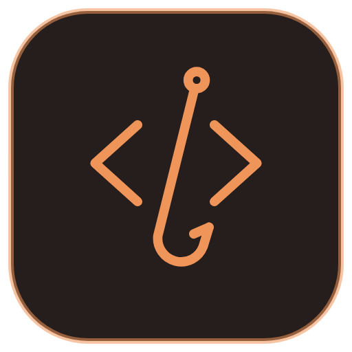

<div align="center">



# Trawler

**Cast a URL. Haul back the whole template.**


</div>

Trawler is a desktop app that mirrors a website template, static or built by JavaScript, into a folder on your disk. It keeps the server's folder structure, so the copy works offline and opens the same way as the original.

## Features

- **Detects the architecture for you.** Static HTML, server-rendered, or built by JavaScript: Trawler scores the page and picks the right mode (you can force Static or JS).
- **Analyze first.** A dry run counts pages, assets and external hosts, and recommends settings before anything is written.
- **Checks its own work.** After a download every page is verified for missing files, and the result opens in a local preview.
- **Polite to servers.** Adjustable parallelism and delay, `Retry-After` backoff on rate limits, `robots.txt` respected by default.
- **Handles bot-protection pages** that a normal browser can pass, using a hidden browser window in the same session.
- **Recent list and repeat.** Run a past job again with the same settings, open its folder or preview it.
- **Everything is a setting.** Depth, page limit, timeouts, user agent, excludes and more, each with a safe default.
- **Headless mode** for scripts, with JSON progress events and exit codes.

## Download

Get the latest build from the [Releases](../../releases) page:

| File | What it is |
| --- | --- |
| `Trawler-Setup-x.y.z.exe` | Installer. Per-user by default, you choose the folder. |
| `Trawler-x.y.z-portable.exe` | No install. Keeps its data in a `TrawlerData` folder next to it. |

> **The builds are not code-signed.** Windows SmartScreen shows a warning the first time: click *More info*, then *Run anyway*.

## How to use it

1. Paste the template's demo URL, for example its `index.html`.
2. Press **Analyze** to see what Trawler would download, and adjust the settings.
3. Choose an output folder and press **Download**.
4. Open the folder, or press **Preview** to run the copy in your browser.

## Legal

> Use Trawler only on templates you hold a license for, free or open templates, and your own sites. Mirroring a paid template's demo without a license infringes the author's copyright. Respect each site's terms of use. You are responsible for what you download.

## Command line

```
npm start -- --trawler-cli --url https://example.com/template/ --out ./mirror
npm start -- --trawler-cli --kind analyze --url https://example.com/template/
```

Options: `--kind download|analyze`, `--mode auto|static|js`, `--policy overwrite|merge|fail`, `--settings '<json>'`. Progress goes to stderr as JSON lines; the result is one line starting with `TRAWLER_RESULT `. Exit codes: `0` done, `1` failed, `2` cancelled, `64` bad arguments. More in [docs/BUILDING.md](docs/BUILDING.md).

## Development

```
npm install
npm test                # unit + Node integration
npm run typecheck
npm start               # build the main process and launch the app
npm run test:electron   # real Electron tests
npm run test:e2e        # UI end-to-end tests
npm run dist            # installer + portable exe in release/
```

Built with Electron, TypeScript, React and Vite. Building, packaging and headless details are in [docs/BUILDING.md](docs/BUILDING.md). The design is in [docs/development/design.md](docs/development/design.md).

## License

[MIT](LICENSE) &copy; 2026 RKEUS
